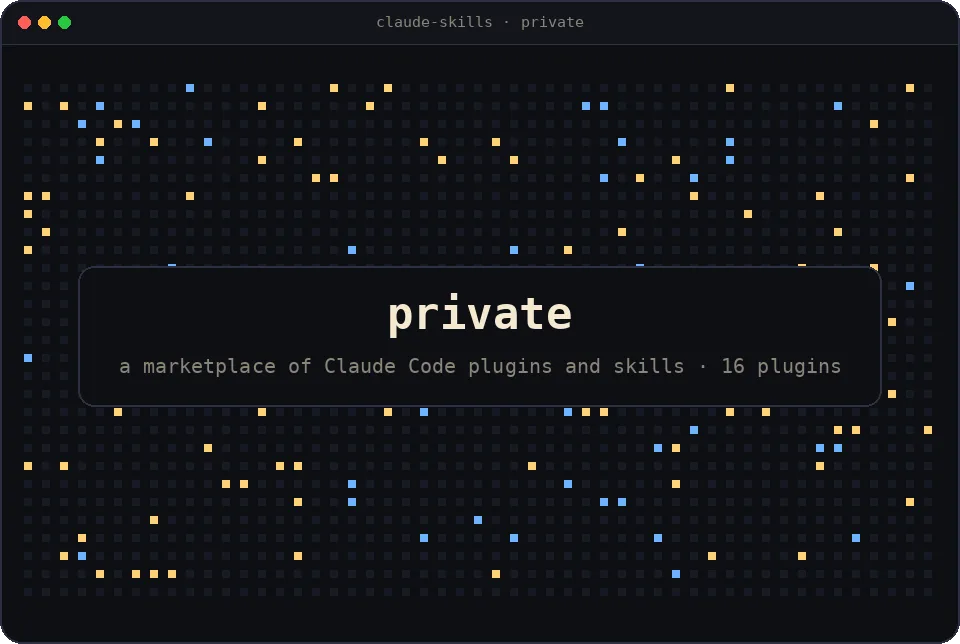

# Miguel Lourenço

AI Engineer with a full-stack background · Lisbon

<!-- VOICE: replace with Miguel's own words — one sentence on what you build and why. -->
I build products end to end, and lately most of my time goes into the parts where a model has to make the call.

[](#work)

*A city of my last 365 days: one building per day, taller when I contributed more, one lit window per contribution. The moon fills up with my current streak.*

[](#work)

*My public repos as stars: bigger star, more lines of code. Repos written mainly in the same language form one constellation. The pulsing stars got commits most recently.*

## Work

<table>
  <tr>
    <td width="50%" valign="top">
      <a href="https://o-guardanapo.site"></a>
      <h3>O Guardanapo <sub>in production</sub></h3>
      <p>Restaurant management platform for a Portuguese restaurant open for more than thirty years: daily menus, a product catalogue with allergens and dietary labels, customer reviews, an admin panel, three languages.</p>
      <p><code>Next.js</code> <code>TypeScript</code> <code>Supabase</code> <code>Playwright</code> <code>Turborepo</code></p>
      <p><a href="https://o-guardanapo.site">o-guardanapo.site</a> · source private (client project)</p>
    </td>
    <td width="50%" valign="top">
      
      <h3>Job Hunt Hub <sub>demo soon</sub></h3>
      <p>AI-augmented job-search workspace: one system of record for applications, with resume scoring, cover-letter generation and interview feedback done by models you can swap.</p>
      <p><code>Next.js 16</code> <code>React 19</code> <code>Supabase</code> <code>Vercel AI SDK</code> <code>Vitest</code></p>
      <p>source on request</p>
    </td>
  </tr>
  <tr>
    <td width="50%" valign="top">
      <a href="https://agentichub-64abdc.gitlab.io"></a>
      <h3>Agentic Hub <sub>proof of concept, Edgen</sub></h3>
      <p>A marketplace where autonomous AI agents offer services, collaborate and transact with each other and with people. Built as a proof of concept at Edgen.</p>
      <p><code>Next.js</code> <code>TypeScript</code> <code>Tailwind</code></p>
      <p><a href="https://agentichub-64abdc.gitlab.io">live demo</a> · <a href="https://github.com/miguel-lourenco-main/agentic-hub">code</a></p>
    </td>
    <td width="50%" valign="top">
      <a href="https://sonora-d09e63.gitlab.io"></a>
      <h3>Sonora <sub>built at Edgen</sub></h3>
      <p>Interactive AI audiobook platform: branching stories narrated by ElevenLabs voices, chosen by the listener as they go.</p>
      <p><code>Next.js</code> <code>TypeScript</code> <code>ElevenLabs</code> <code>Framer Motion</code></p>
      <p><a href="https://sonora-d09e63.gitlab.io">live demo</a> · <a href="https://github.com/miguel-lourenco-main/sonora">code</a></p>
    </td>
  </tr>
  <tr>
    <td width="50%" valign="top">
      <a href="https://ui-components-5218c2.gitlab.io"></a>
      <h3>UI Components <sub>playground</sub></h3>
      <p>A React component library set like an editorial, with a live playground, six themes, version history and an MCP endpoint through which agents propose new components.</p>
      <p><code>React</code> <code>TypeScript</code> <code>Tailwind</code> <code>Monaco</code> <code>Playwright</code></p>
      <p><a href="https://ui-components-5218c2.gitlab.io">live demo</a> · <a href="https://github.com/miguel-lourenco-main/ui-components">code</a></p>
    </td>
    <td width="50%" valign="top">
      
      <h3>Claude Code plugins <sub>private</sub></h3>
      <p>A marketplace of plugins and skills I use every day: git hygiene across a fleet of repos, UI/UX extraction from reference sites, design-to-spec pipelines, and a model router that puts a tiny decision model in front of the large ones.</p>
      <p><code>Claude Code</code> <code>Python</code> <code>TypeScript</code> <code>GitHub Actions</code></p>
      <p>private · ask me about it</p>
    </td>
  </tr>
</table>

## Recent work

*What I actually committed lately, straight from the public repos, plus today's numbers. Nothing to wait for: the session is already finished.*

[](#recent-work)

<!-- SESSION:START -->
<details><summary>plain text</summary>

```console
$ git log --since="180 days ago" --oneline --author=miguel
35f3c42  my-cv           chore: add .cursor cv-bullet-from-image skill                                                2mo ago
557fb2a  cash-register   Portal the order detail panel so it can be closed on mobile                                  3mo ago
d624060  cash-register   Allow entering an arbitrary tendered amount at payment                                       3mo ago
2d3d610  cash-register   Add back button to order details for mobile navigation                                       3mo ago
22de888  ui-components   feat(requests): baseline diffs, version history, and API-compat checks                       3mo ago
3827eea  ui-components   feat(playground): AST-based compile core, Monaco types, and live code mode                   3mo ago
7b862b5  my-cv           ci: style local CI jobs with report-style logging                                            3mo ago
9a10f93  my-cv           chore: update .gitignore and edgen-code readme                                               3mo ago
$ contributions --today
today 0 · this week 37 · last 30 days 401 · streak 1d · 3,093 in the last year
$ wc -l --by-language ~/src
127,287 lines · TypeScript 100.4k · OCaml 18.1k · JavaScript 4.1k · CSS 3.8k · SQL 0.7k
$
```

</details>
<!-- SESSION:END -->

[migasoulou@gmail.com](mailto:migasoulou@gmail.com) · [github.com/miguel-lourenco-main](https://github.com/miguel-lourenco-main)

<sub>The skyline and constellation are redrawn nightly by <a href=".github/workflows/art.yml">art.yml</a>, the session hourly by <a href=".github/workflows/session.yml">session.yml</a>, the work cards monthly by <a href=".github/workflows/screenshots.yml">screenshots.yml</a> · last redraw <!-- REDRAW:START -->2026-10-12 12:21 UTC<!-- REDRAW:END --></sub>
