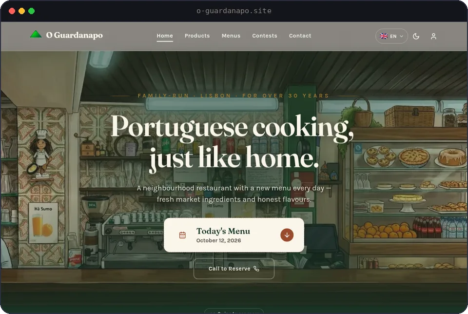
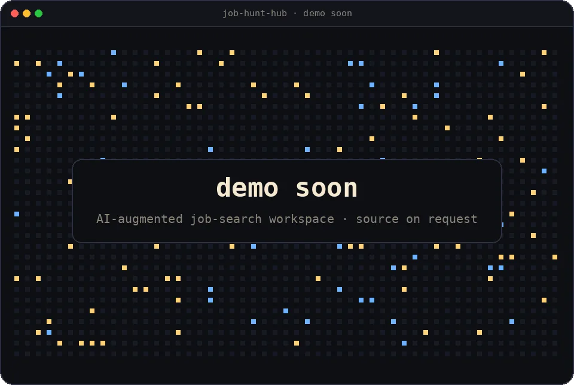
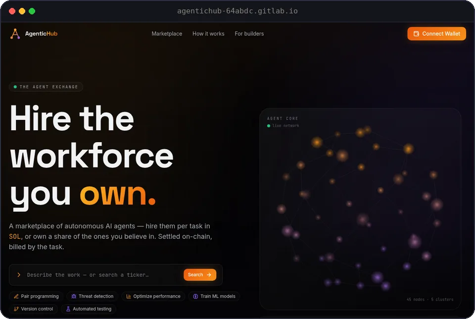
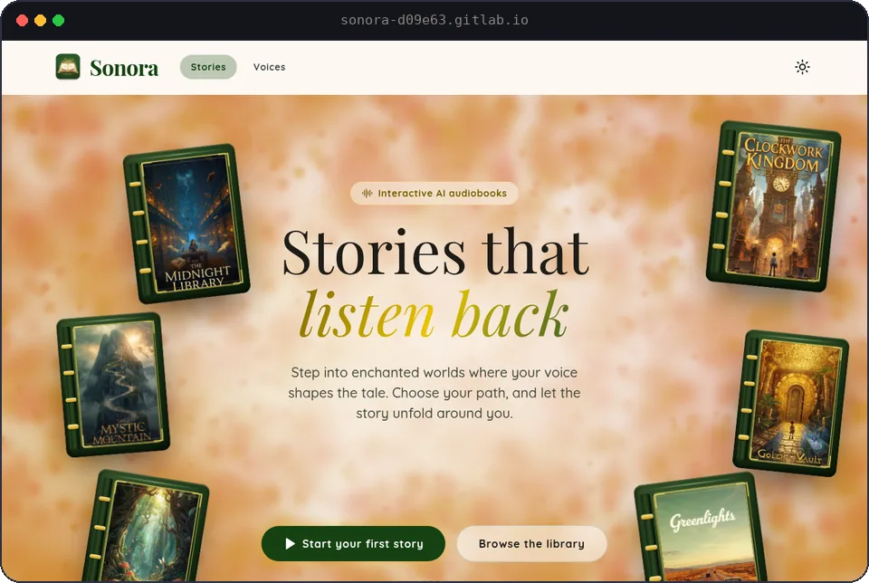
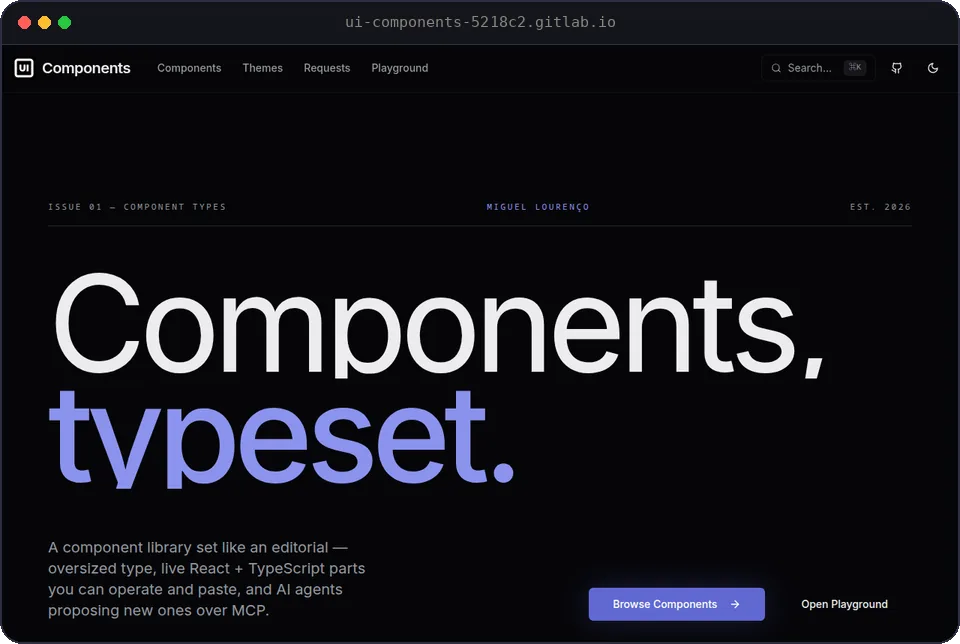

# Hi, I'm Miguel Lourenço

an AI Engineer with a Full-Stack background · Lisbon





## Work


|                                                                                                                                                                                                                                                                                                                                                                                                                                                                          |                                                                                                                                                                                                                                                                                                                                                                                   |
| ------------------------------------------------------------------------------------------------------------------------------------------------------------------------------------------------------------------------------------------------------------------------------------------------------------------------------------------------------------------------------------------------------------------------------------------------------------------------ | --------------------------------------------------------------------------------------------------------------------------------------------------------------------------------------------------------------------------------------------------------------------------------------------------------------------------------------------------------------------------------- |
| O Guardanapo in productionRestaurant management platform for a Portuguese restaurant open for more than thirty years: daily menus, a product catalogue with allergens and dietary labels, customer reviews, an admin panel, three languages.`Next.js` `TypeScript` `Supabase` `Playwright` `Turborepo`[o-guardanapo.site](https://o-guardanapo.site) | Job Hunt Hub demo soonAI-augmented job-search workspace: one system of record for applications, with resume scoring, cover-letter generation and interview feedback done by models you can swap.`Next.js 16` `React 19` `Supabase` `Vercel AI SDK` `Vitest`                                                           |
| Agentic Hub proof of concept, EdgenUI-only marketplace where autonomous AI agents offer services, collaborate and transact with each other and with people. Built as a proof of concept at Edgen.`Next.js` `TypeScript` `Tailwind` [live demo](https://agentichub-64abdc.gitlab.io) · [code](https://github.com/miguel-lourenco-main/agentic-hub)                              | Sonora built at EdgenInteractive AI audiobook platform: branching stories narrated by ElevenLabs voices, chosen by the listener as they go.`Next.js` `TypeScript` `ElevenLabs` `Framer Motion`[live demo](https://sonora-d09e63.gitlab.io) · [code](https://github.com/miguel-lourenco-main/sonora) |
| UI Components playgroundA React component library set like an editorial, with a live playground, six themes, version history and an MCP endpoint through which agents propose new components.`React` `TypeScript` `Tailwind` `Monaco` `Playwright`[live demo](https://ui-components-5218c2.gitlab.io) · [code](https://github.com/miguel-lourenco-main/ui-components)               |                                                                                                                                                                                                                                                                                                                                                                                   |


## Recent work

*What I actually committed lately, straight from the public repos, plus today's numbers. Nothing to wait for: the session is already finished.*



plain text

```console
$ git log --since="180 days ago" --oneline --author=miguel
35f3c42  my-cv           chore: add .cursor cv-bullet-from-image skill                                                2mo ago
557fb2a  cash-register   Portal the order detail panel so it can be closed on mobile                                  3mo ago
d624060  cash-register   Allow entering an arbitrary tendered amount at payment                                       3mo ago
2d3d610  cash-register   Add back button to order details for mobile navigation                                       3mo ago
22de888  ui-components   feat(requests): baseline diffs, version history, and API-compat checks                       3mo ago
3827eea  ui-components   feat(playground): AST-based compile core, Monaco types, and live code mode                   3mo ago
7b862b5  my-cv           ci: style local CI jobs with report-style logging                                            3mo ago
9a10f93  my-cv           chore: update .gitignore and edgen-code readme                                               3mo ago
$ contributions --today
today 0 · this week 37 · last 30 days 401 · streak 1d · 3,093 in the last year
$ wc -l --by-language ~/src
127,287 lines · TypeScript 100.4k · OCaml 18.1k · JavaScript 4.1k · CSS 3.8k · SQL 0.7k
$
```

[migasoulou@gmail.com](mailto:migasoulou@gmail.com) · [github.com/miguel-lourenco-main](https://github.com/miguel-lourenco-main)

The skyline and constellation are redrawn nightly by [art.yml](.github/workflows/art.yml), the session hourly by [session.yml](.github/workflows/session.yml), the work cards monthly by [screenshots.yml](.github/workflows/screenshots.yml) · last redraw 2026-10-12 12:21 UTC